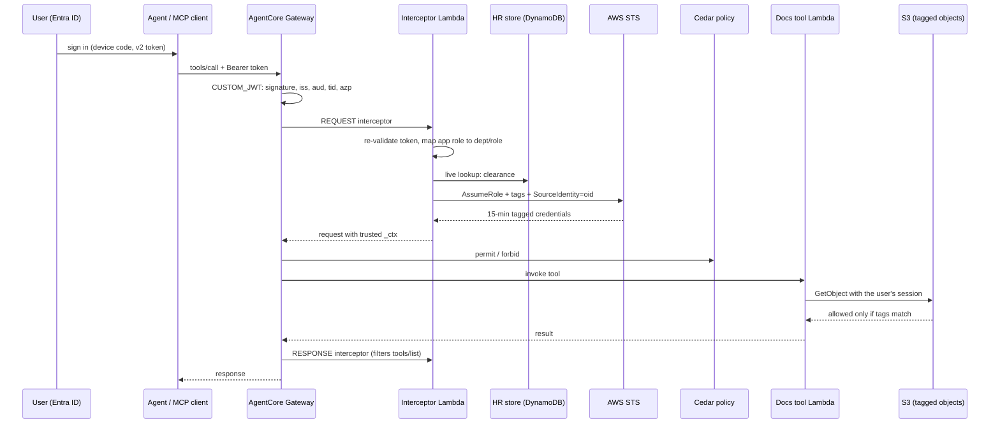

# Entra ID → AgentCore Gateway → STS session tags: identity propagation lab

An AI agent should act with the permissions of the **human who asked**, not its own. This lab
connects a Microsoft Entra ID tenant to Amazon Bedrock AgentCore Gateway so the user's identity
and attributes travel with every tool call, as AWS STS session tags, down to the data. Four
independent layers then enforce access, and every action is traceable to a person in CloudTrail.



## What it proves

| Layer | Control | Example in the test matrix |
|---|---|---|
| 1. Gateway inbound auth | CUSTOM_JWT against the Entra v2 discovery URL; audience, tenant (`tid`) and calling app (`azp`) pinned | Token for Microsoft Graph, or tampered token → 401 |
| 2. Interceptor (broker) | Re-validates the token, applies the attribute contract, live clearance lookup, mints a tagged STS session, strips forged identity | Forged `_ctx` in the request is discarded |
| 3. Cedar policy | Deterministic `forbid` on the bulk-export tool unless the user is a manager | Analyst and contractor cannot export |
| 4. S3 ABAC | `aws:PrincipalTag/dept` and `clr` must match `s3:ExistingObjectTag/dept` and `sensitivity` | Alice cannot read HR files or restricted finance files |
| Audit | `SourceIdentity` = Entra object ID on every session; interceptor decision log | CloudTrail shows who, with which tags |

### Data-side modules (Cyera-, Immuta- and Varonis-style)

The core lab answers *who is asking*. Three add-on modules cover the data side, built with
AWS-native parts and mapped to where the real products plug in: **[docs/DATA_SECURITY_MODULES.md](docs/DATA_SECURITY_MODULES.md)**.

| Module | Stands in for | Control | Proof |
|---|---|---|---|
| C: classification drives tags | Cyera (DSPM) | Amazon Macie finds card numbers/SSNs in a file mislabelled `public`; an adapter raises its `sensitivity` tag (labels only go up) | The contractor's read flips from ALLOW to DENY with no policy change |
| I: row and column policies | Immuta | Policy written once: subscription, row filter by `dept`, mask pay columns unless `clr=restr`; DynamoDB `LeadingKeys`/`Attributes` enforce the same thing in IAM | S19-S22: Alice gets masked fin rows, Bob full hr rows, Carol refused |
| V: activity analytics | Varonis | CloudTrail data events + SourceIdentity -> per-person report; BULK_READ, PROBING, EXPOSURE alerts | One IAM role resolves to named people; the exposure alert shows who read the file before it was relabelled |

The tool Lambda's own IAM role has **no S3 permissions at all**. It can only read data with the
caller's tagged session, so a bug in the tool cannot leak data beyond what the human could see.

## Personas

| Persona | Entra app role | Session tags (dept / role / clr) | Can read |
|---|---|---|---|
| Alice | Finance.Analyst | fin / analyst / internal | finance public + internal |
| Bob | HR.Manager | hr / manager / restr | all HR, can bulk export |
| Carol | Finance.Contractor | fin / contractor / public | finance public only |
| Dave | *(none)* | — | nothing: Entra refuses to issue the token |

## Results from a live run

All numbers below come from a real run against a personal Entra ID tenant and AWS account
(IDs redacted); the raw outputs are in [`evidence/`](evidence/).

| What | Result |
|---|---|
| Persona x tool test matrix | **22/22 passed** across gateway auth, interceptor, Cedar, S3 ABAC, data policy and DynamoDB FGAC ([results](evidence/results-22.md)) |
| Local unit tests | **56 passed** (fake Entra JWKS + moto), including 15 fail-closed cases in the interceptor |
| Break-it exercises | 6 of 6 behaved as designed: v1 token trap (11/18 until fixed in Entra), missing `sts:TagSession` fails closed, live clearance downgrade, role-removal lag vs AADSTS50105, Cedar LOG_ONLY with S3 still blocking, direct tool invocation refused |
| IAM Access Analyzer | Caught two real trust-policy errors during the build (condition keys unsupported for `sts:SetSourceIdentity`); fixed before deploy |
| DSPM (Macie) | Found bank account numbers and SSNs in a file mislabelled `public`; label raised to `restr`; the contractor's next read was denied with no policy change ([findings](evidence/dspm_findings.md)) |
| Activity analytics | 20 agent events on one IAM role resolved to 3 named people; alerts: EXPOSURE (contractor read the file before relabelling), PROBING, BULK_READ ([report](evidence/access_report.md)) |
| Audit | CloudTrail AssumeRole events carry SourceIdentity = Entra object ID and the session tags ([audit trail](evidence/audit_trail.md)) |

## Quick start

Full walkthrough with timings, expected output and troubleshooting: **[docs/LAB_GUIDE.md](docs/LAB_GUIDE.md)**.

```bash
python -m venv .venv && source .venv/bin/activate        # Windows: .venv\Scripts\activate
pip install -r requirements-dev.txt
pytest -q                                                 # 56 local tests, no cloud needed

az login --tenant <TENANT_ID> --allow-no-subscriptions
python entra/setup_entra.py                               # apps, roles, test users
python client/get_token.py all                            # sign in as each persona

aws configure                                             # or AWS_PROFILE=...
python monitor/enable_data_events.py                      # optional, module V: record data access first
python aws/deploy.py --region us-east-1                   # everything on AWS
python client/run_scenarios.py                            # 22-scenario test matrix -> evidence/results.md
python client/collect_evidence.py                         # CloudTrail + interceptor audit -> evidence/audit_trail.md
# data-side modules C, I, V: see docs/DATA_SECURITY_MODULES.md

python aws/teardown.py --region us-east-1 && python entra/teardown_entra.py
```

## Repository layout

```
entra/        setup_entra.py, teardown_entra.py       Microsoft Graph via your az login
aws/          deploy.py, teardown.py                  boto3; idempotent, validates IAM with Access Analyzer
aws/policies/ trust, ABAC and permission policies     templated JSON
aws/cedar/    permit_all, forbid_export_unless_manager
lambdas/      interceptor/ (broker), data_tool/ (docs tool + Immuta-style data_policy.py / data_policies.json)
client/       get_token.py, call_tool.py, run_scenarios.py, collect_evidence.py
dspm/         classify.py                             module C: Macie classification -> sensitivity tags
monitor/      enable_data_events.py, access_report.py module V: CloudTrail data events -> per-person alerts
data/         sample documents, structured/employees.json, planted/ (fake sensitive file for module C)
tests/        pytest suite: local JWKS + moto, no cloud needed
docs/         LAB_GUIDE.md, DATA_SECURITY_MODULES.md, DESIGN.md, INTERVIEW_PREP.md
evidence/     generated results and your screenshots
```

## Design notes

See [docs/DESIGN.md](docs/DESIGN.md) for the attribute contract, the threat model and the
trade-offs (why a broker instead of `AssumeRoleWithWebIdentity`, why clearance is a live lookup,
why `customClaims` instead of `allowedClients` for Entra tokens).

## Cost and safety

Everything runs on on-demand services (Lambda, DynamoDB on-demand, S3, AgentCore Gateway and
Policy per-request pricing). A lab run should cost very little, but check the pricing pages for
your region and **run the teardown scripts when you finish**. Only sample data is used; test user
passwords live in `.lab/entra.json`, which is git-ignored.

This is a learning lab, not a production reference. See the "Production gaps" section in DESIGN.md.
